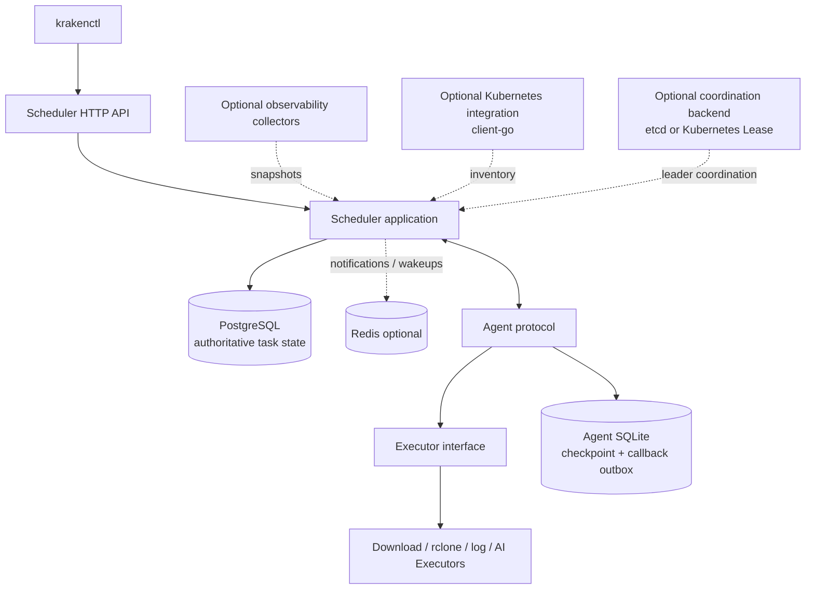

# Kraken Orchestrator

> **Distributed Task Orchestration Platform** — a Go-based platform for scheduling and executing long-running, recoverable workloads across multiple Agents.

[简体中文](README.zh-CN.md) · [Architecture](docs/architecture/overview.md) · [Roadmap](ROADMAP.md) · [Changelog](CHANGELOG.md)

## Project status

**Engineering status: design baseline and implementation plan.** This repository documentation describes the intended architecture and acceptance criteria. A capability must not be presented as implemented until its code, tests, deployment artifacts, and operational behavior have been verified. See the [capability status table](#capability-status) and [Roadmap](ROADMAP.md).

## Why Kraken

Kraken targets workloads that may run for hours, days, or weeks, including downloads, data synchronization with rclone, log collection, and AI-related processing. Its primary engineering goals are reliable execution, recovery after failures, explicit task-state transitions, and a modular path from a single Docker host to Agents on multiple machines.

The initial deployment is intentionally modest: one Scheduler, one Agent, PostgreSQL, and optional Redis under Docker Compose. The architecture should support roughly 10–50 Agents in a later phase without prematurely splitting the system into many microservices.

## Project identity

| Item | Canonical name |
|---|---|
| Repository | `kraken-orchestrator` |
| Scheduler process | `kraken-scheduler` |
| Agent process | `kraken-agent` |
| CLI | `krakenctl` |
| Compose services | `scheduler`, `agent`, `postgres`, `redis` |

Go entry points:

```text
cmd/kraken-scheduler/main.go
cmd/kraken-agent/main.go
cmd/krakenctl/main.go
```

The Go module path must match the repository's actual remote URL. Do not invent a hosting domain or copy an example module path into production code.

## Architecture at a glance



The optional integrations are deliberately outside the task-state authority path:

- **PostgreSQL** owns task state, attempts, leases, events, and transactional outbox records.
- **Redis** may accelerate notifications or wakeups. It is never the only durable record of a task.
- **eBPF** may provide node/process runtime telemetry. Telemetry is advisory and must not decide task success by itself.
- **client-go** may maintain Kubernetes inventory and discover Agent Pods. Kubernetes Pod state is not a substitute for Agent protocol state.
- **etcd or Kubernetes Lease** may coordinate explicitly single-instance control loops. They do not replace PostgreSQL task claims or fencing checks.

See [Architecture Overview](docs/architecture/overview.md), [Task State Machine](docs/design/task-state-machine.md), and the integration design documents.

## Capability status

The table below is a documentation baseline, not an assertion about the current source tree. Update it only after checking code and tests.

| Capability | Target | Verified implementation | Evidence to record |
|---|---|---|---|
| Three Go entry points | Required | Not verified here | Build output and startup tests |
| Scheduler HTTP API | Required | Not verified here | API tests and OpenAPI/spec documentation |
| PostgreSQL task persistence | Required | Not verified here | Migrations and repository integration tests |
| Atomic claim / lease / fencing | Required | Not verified here | Concurrent-claim and stale-callback tests |
| Agent heartbeat and recovery | Required | Not verified here | Restart and lease-expiry tests |
| SQLite checkpoint / callback outbox | Required | Not verified here | Agent recovery and retry tests |
| Redis notifications | Optional | Not verified here | PostgreSQL-only fallback test |
| Download Executor | First real executor | Not verified here | Range/checksum/disk-space integration tests |
| Kubernetes client-go integration | Later | Planned | Kind integration tests and RBAC review |
| eBPF runtime observer | Later | Planned | Kernel matrix, privilege review, measurement tests |
| etcd coordination | Conditional | Planned | Leader-loss and stale-leader safety tests |

## Documentation map

- `ROADMAP.md` — milestones, entry criteria, exit criteria, and status tracking.
- `CHANGELOG.md` — user-visible changes by release.
- `docs/architecture/` — system boundaries and runtime responsibilities.
- `docs/design/` — task state, leases, fencing, delivery, and recovery.
- `docs/integrations/` — eBPF, Kubernetes client-go, and etcd integration contracts.
- `docs/operations/` — security, Compose deployment, and troubleshooting.
- `docs/development/` — testing and contribution workflow.
- `docs/benchmarks/` — reproducible performance test plan and result template.
- `docs/adr/` — architecture decision records.

## Development principles

1. Keep business logic in `internal/`; keep `cmd/*/main.go` focused on configuration, dependency wiring, startup, and shutdown.
2. Make state transitions explicit and reject invalid transitions.
3. Treat delivery as **at least once** and make side effects idempotent or safely fenced. Do not claim exactly-once execution.
4. Persist state before acknowledging externally visible side effects.
5. Put timeouts on I/O and database operations; use bounded queues and goroutine pools.
6. Propagate cancellation, redact secrets, validate external input, and close resources during graceful shutdown.
7. Add tests and update documentation with every meaningful behavior change.
8. Do not silently change API contracts, task state semantics, migration behavior, or configuration names.

## Local development

The precise commands depend on the repository's actual `go.mod`, Makefile, and Compose file. At minimum, a change should pass the applicable checks below (adapt names to the checked-in scripts; do not add placeholder scripts that appear to pass):

```bash
gofmt -w ./cmd ./internal
go vet ./...
go test ./...
go test -race ./...
go build ./cmd/kraken-scheduler
go build ./cmd/kraken-agent
go build ./cmd/krakenctl
```

Database integration tests require an explicitly configured test PostgreSQL instance and must never point at production data. Tests should not depend on public network services unless explicitly marked as opt-in integration tests.

## Deployment boundary

The initial supported deployment target is a single Docker host using Docker Compose. A single host is a single failure domain: restart policies do not provide machine-level high availability. Persistent PostgreSQL and Agent data, dependency reconnection, health checks, secret handling, and backup/restore procedures are required before production use.

Kubernetes packaging and multi-Scheduler deployment are later milestones, not prerequisites for the first reliable release.

## Contributing

Before changing the system, read `AGENTS.md` and the relevant design document. See [Testing Strategy](docs/development/testing.md). Prefer focused pull requests with tests, migration notes, operational impact, and documentation updates.

## License

No license is asserted by this documentation package. Add a repository-level `LICENSE` only after the project owner chooses and verifies the intended license.
